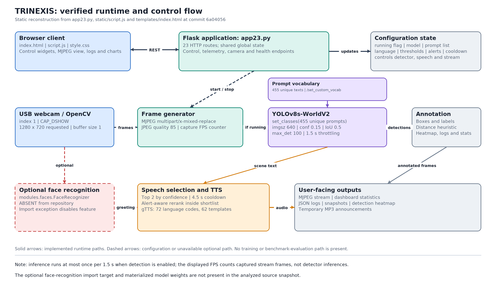
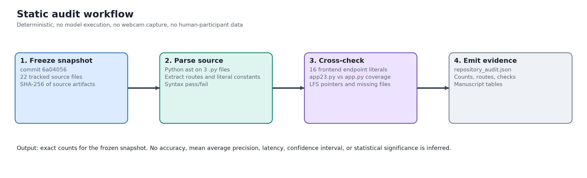

# TRINEXIS: Design and Implementation of a Web-Based Open-Vocabulary Detection System with Multilingual Speech and Session Telemetry

**Authors and Affiliations**

Yug G. Lakhani¹  
¹Department of Computer Engineering, Gyanmanjari Innovative University, Bhavnagar, Gujarat, India  
Corresponding author: Yug G. Lakhani, yglakhani@gmiu.edu.in  
ORCID: https://orcid.org/0009-0004-2930-4953  

## Abstract

Open-vocabulary object detectors are increasingly available, but a working research prototype also requires reproducible documentation of its control flow, configuration, interfaces, and evidentiary limits. This paper examines the tech_yolo repository, which implements TRINEXIS, a Flask-based web application combining a YOLOv8s-WorldV2 detector, a browser dashboard, multilingual speech output, detection logs, and optional face-recognition hooks. The repository contains no annotated dataset, benchmark log, training script, pinned dependency manifest, or human-participant evaluation. Therefore, this study asks what can be verified from the implementation itself and what cannot be claimed without new experiments. A deterministic static audit was performed on commit 6a040561 using Python's standard-library abstract syntax tree parser; no model inference, training, webcam capture, or user study was conducted. The primary backend exposes 23 HTTP routes, while the browser script references 16 endpoint literals; all 16 are implemented by that backend, whereas the older backend lacks /set_alerts. The detector is configured with 455 unique text prompts, confidence 0.15, intersection-over-union 0.5, 640-pixel inference size, a 1.5-second throttling interval, and 100 maximum detections. The system defines 72 language codes, 62 speech templates, and 22 face-greeting templates. All five weight files are Git Large File Storage pointers, and a CLIP ViT-B-32 pointer is present but unreferenced by executable Python code; the optional modules.faces import target is absent. These findings establish a precise implementation baseline and a bounded evaluation agenda, but they do not support claims about detection accuracy, latency, robustness, or real-world effectiveness.

**Keywords / Index Terms:** Open-Vocabulary Object Detection; YOLO-World; Flask; Multilingual Text-to-Speech; Human-Computer Interface; Reproducible System Audit

## I. INTRODUCTION

### A. Background and Research Context

Object detection predicts bounding boxes and semantic labels for objects in an image. The YOLO family formulated detection as a single regression problem and established a practical speed-accuracy trade-off for real-time vision systems [1]. Large closed-set benchmarks such as Microsoft COCO standardized evaluation over a fixed vocabulary of 80 released categories [2]. Fixed vocabularies are useful for benchmarking but restrict applications that need to name objects not present in the original label set.

Vision-language pre-training broadened this interface. CLIP learned transferable image and text representations from 400 million image-text pairs and enabled zero-shot transfer through natural-language prompts [3]. Open-set detectors such as Grounding DINO fused language and vision modalities to accept category names or referring expressions [4]. YOLO-World subsequently proposed a prompt-then-detect paradigm with a re-parameterizable vision-language path aggregation network and region-text contrastive loss [5]. Ultralytics exposes a YOLO-World interface in which set_classes configures a custom text vocabulary before prediction [6]. These advances make it feasible to build interactive applications around user-selected object names rather than a fixed class list.

A complete application also requires web serving, camera capture, state management, user-interface controls, and output generation. The analyzed repository combines Flask [7], OpenCV video capture [8], Ultralytics YOLO [6], and gTTS [9] in a single Python process. Its browser interface exposes controls for detection state, model selection, confidence, interval, resolution, language, speech, custom vocabulary, alerts, logs, snapshots, and heatmaps.

### B. Problem Statement

The repository provides a working prototype but no research manuscript, requirements manifest, experimental dataset, benchmark output, or deployment study. Consequently, conventional research claims about detection accuracy, mean average precision (mAP), inference speed, multilingual comprehension, or assistive effectiveness cannot be verified. The specific problem addressed here is the absence of a precise, reproducible account of what the implemented system contains, how its components interact, which settings are active, and which claims remain unsupported.

The scope is therefore a system description and static audit of the source snapshot identified by commit 6a0405613171a5ed400a7339c3e0a8f6bb94b26d [11]. The study does not evaluate participants, train a model, or compare detectors on an external dataset.

### C. Research Gap

The cited detection literature primarily reports architectures, training protocols, and benchmark results under controlled datasets [1]-[5]. Those publications do not describe this particular application repository, nor do they establish the behavior of its integrated speech, telemetry, and web-control layers. A gap exists between the availability of pre-trained open-vocabulary models and a verifiable implementation-level specification for this prototype. Closing that gap is a prerequisite for any later empirical comparison; it is not a substitute for such a comparison.

A further gap is evidentiary. The repository contains Git LFS pointer files rather than materialized model weights [10], an optional modules.faces import that has no corresponding source file, and no license or pinned dependency list. These conditions affect reproducibility and must be reported rather than hidden.

### D. Research Objectives and Research Questions

The objective is to produce an honest system specification and a reproducible audit that separates verified implementation facts from unverified performance claims. Three research questions are addressed:

- RQ1: What is the implemented data and control flow from webcam capture through detection, annotation, speech, and browser presentation?
- RQ2: Which routes, prompt vocabularies, language resources, hyperparameters, and artifact dependencies can be verified from the frozen source snapshot?
- RQ3: What evidence is absent, and which evaluation protocol would be required before making claims about detection quality, latency, robustness, or user benefit?

### E. Proposed Approach

The paper reconstructs the architecture from the primary backend and frontend, derives equations for the implemented distance and heatmap heuristics, and performs a deterministic static audit. The audit parses Python source with the standard-library abstract syntax tree module, extracts literal configuration assignments and route decorators, compares frontend endpoint literals with backend routes, and classifies weight and media artifacts. The procedure is intentionally non-executing: it does not import external packages, load weights, open a camera, or transmit text to a speech service.

### F. Research Contributions

- A verified architecture and component inventory for TRINEXIS, with app23.py identified as the backend aligned with the current browser interface and app.py retained as an earlier variant.
- A precise account of the runtime configuration, including 455 unique prompts, 23 HTTP routes in the primary backend, and the active inference, speech, and logging parameters.
- A checked-in, standard-library audit script and a machine-readable JSON result file that reproduce every count reported in the Results section.
- An explicit evidence boundary and a future evaluation protocol that prevents unsubstantiated accuracy, latency, robustness, or real-world-effectiveness claims.

### G. Paper Organization

Section II reviews related detection and interface technologies. Section III describes the system, data sources, preprocessing, model interface, equations, implementation environment, and appropriate metrics. Section IV defines the static experiments. Section V reports the audit results. Section VI interprets the findings, documents implementation-level error cases, and states limitations. Section VII concludes and identifies future work. Declarations, references, and appendices follow.

## II. RELATED WORK / LITERATURE REVIEW

### A. Existing Research Approaches

Research relevant to this system can be grouped into four themes. First, one-stage detectors established efficient bounding-box prediction [1]. Second, benchmark datasets supplied fixed class vocabularies and annotation protocols [2]. Third, vision-language pre-training and open-set detection replaced fixed labels with text-conditioned recognition [3]-[5]. Fourth, software frameworks connect models to cameras, browsers, and speech services [6]-[9]. This paper uses the first three themes to position the detector and the fourth to explain the integration.

Table I summarizes verified information from these sources. Reported speeds, dataset sizes, and benchmark conditions are not used as comparative baselines for TRINEXIS because the present study did not run a detector on a benchmark dataset. The table therefore emphasizes scope and non-comparability rather than implying a ranking.

**TABLE I. RELATED WORK: VERIFIED CONTRIBUTIONS AND NON-COMPARABILITY**

| Source / year | Method or artifact | Dataset or scope | Verified evidence | Relevance and limitation |
| --- | --- | --- | --- | --- |
| Redmon et al. [1], 2016 | YOLO one-stage detector | PASCAL VOC and COCO-era benchmarks | Base model reported 45 frames/s; Fast YOLO reported 155 frames/s; the paper notes more localization errors | Foundation for efficient detection; closed-set categories and a different hardware/protocol context |
| Lin et al. [2], 2014 | Microsoft COCO benchmark | 328,000 images and 2.5 million labeled instances; 80 released detection categories | Provides instance annotations and standard evaluation conventions | utils/coco.txt contains 80 labels but no images, annotations, or split files |
| Radford et al. [3], 2021 | CLIP contrastive pre-training | 400 million image-text pairs; zero-shot evaluation over more than 30 datasets | Natural-language supervision enables zero-shot transfer | Representation learning, not a real-time bounding-box detector |
| Liu et al. [4], 2023; revised 2024 | Grounding DINO open-set detector | Text-prompted open-set detection | Tight vision-language fusion across feature, query, and decoder stages | Alternative open-set approach; not used in this repository and evaluated under different protocols |
| Cheng et al. [5], 2024 | YOLO-World and RepVL-PAN | Large-scale detection, grounding, and image-text pre-training | CVPR 2024, pp. 16901-16911; prompt-then-detect open-vocabulary detection | Direct research basis for the selected model family; source benchmark results are not reproduced here |
| Ultralytics [6], accessed 2026 | YOLO-World software documentation | yolov8s-worldv2.pt and set_classes() | Documents custom prompt configuration before inference | Software documentation, not a peer-reviewed performance comparison |

### B. Comparison of Existing Methods

Closed-set YOLO detectors and COCO-style evaluation provide strong comparability when the label set and split are fixed [1], [2]. CLIP and Grounding DINO relax the fixed-label assumption but differ in output type and computational design [3], [4]. YOLO-World is closest to the implemented detector because it retains a YOLO-style architecture while accepting a text vocabulary [5], [6]. Nevertheless, the published studies evaluate pre-trained models on curated benchmarks; they do not evaluate this repository's throttled webcam loop, gTTS worker, browser state, or heuristic distance overlay. Any claim of superiority would therefore be unfair without a new controlled experiment.

### C. Research Gap Analysis

Prior work establishes efficient detection, language-conditioned recognition, and reusable software components. What remains for the present study is a verifiable account of a concrete integration. In particular, the literature does not specify this repository's 455-prompt vocabulary, 1.5-second inference throttle, two-object speech cap, 72 language-code map, heatmap update rule, or route contract. The proposed work differs from prior benchmark studies by treating the software artifact itself as the object of analysis and by reporting the absence of empirical evidence as a finding. This justifies a system paper with a static audit rather than a performance-ranking paper.

## III. PROPOSED METHODOLOGY

### A. System Overview / Research Design

Figure 1 presents the verified runtime and control flow. A browser client renders templates/index.html and uses static/script.js to call REST endpoints. The Flask backend app23.py maintains shared global state, opens an external USB webcam through OpenCV, streams Motion JPEG frames, and invokes the detector only when the running flag is true and the configured interval has elapsed. Detection results are converted into visual overlays, a distance estimate, a heatmap contribution, session counters, and a short natural-language announcement. The browser polls telemetry endpoints and can export logs, snapshots, and heatmaps.



*Fig. 1. Verified system architecture of TRINEXIS. Solid arrows denote implemented runtime paths; dashed arrows denote configuration or unavailable optional paths. The diagram was reconstructed from source code and does not imply a training or benchmark-evaluation pipeline.*

Table II maps the major system layers to repository artifacts. The primary backend is app23.py because it implements every endpoint literal found in static/script.js, including /set_alerts. app.py is an earlier, smaller variant with 20 routes and no /set_alerts implementation. Both are retained in the repository, but the present methodology treats app23.py as the system under study.

**TABLE II. VERIFIED COMPONENT INVENTORY**

| Layer | Artifact | Verified function | Status at audited commit |
| --- | --- | --- | --- |
| Browser client | templates/index.html; static/script.js; static/style.css | Controls, MJPEG display, polling, charts, snapshot and heatmap views | Present |
| Web server and state | app23.py | 23 routes, global session state, threaded speech queue, frame generator | Primary backend |
| Earlier server variant | app.py | 20 routes and a longer, less constrained speech description | Secondary variant |
| Capture | cv2.VideoCapture in app23.py; camera_test.py | External USB camera index 1, CAP_DSHOW backend, requested 1280 x 720 resolution | Present; Windows-oriented backend |
| Detector | Ultralytics YOLO with yolov8s-worldv2.pt | Open-vocabulary inference using set_classes(VOCABULARY) | Weight file is an LFS pointer only |
| Annotation and telemetry | annotate_frame, update_heatmap, detection_log, stats | Bounding boxes, confidence, distance proxy, heatmap, frequency and timeline counters | Present |
| Speech | gTTS, speech_worker, play_audio_sync | Sequential MP3 synthesis and platform-specific playback | Present; network service dependency |
| Optional face recognition | modules.faces.FaceRecognizer import target | Would label known faces and issue greetings | Absent; disabled by exception handler |
| Repository weights | Five .pt files, including weights/clip/ViT-B-32.pt | Git LFS references to pre-trained model files | All five are pointer files |

### B. Dataset / Materials / Data Sources

No training, validation, or test dataset is present. The audit found no image collections, annotation files, data-split definitions, or benchmark logs among the 22 tracked files. utils/coco.txt contains 80 non-empty and unique COCO category names, but no executable code in app.py, app23.py, or the browser assets reads that file; it is a label list, not an evaluation dataset. No collection period, class distribution, inclusion or exclusion criteria, license, permission statement, or privacy policy is documented for webcam frames.

The materials used in this paper are the source files at commit 6a0405613171a5ed400a7339c3e0a8f6bb94b26d [11] and the derived JSON audit file. Weight artifacts are Git LFS v1 pointer files containing an object identifier and a declared byte size [10]; they are not materialized tensors in the repository snapshot. Six MP3 artifacts are also present: four are zero-byte files and two contain audio data. They are treated as incidental repository outputs, not experimental recordings.

### C. Data Preprocessing

The runtime pipeline performs frame-level transformations but no learned preprocessing. Camera frames are read as OpenCV arrays. The requested capture size is 1280 x 720 with a buffer size of one; detector input is resized by the Ultralytics predict call to IMG_SIZE, initially 640. The frame is encoded as JPEG at quality 85 for the multipart stream. Bounding-box coordinates are converted to integers, and widths and heights are clamped to at least one pixel before the distance calculation. No normalization, missing-value imputation, duplicate removal, augmentation, feature selection, encoding, or outlier handling is implemented for a tabular dataset.

Because no fitted preprocessing exists, there is no train-to-test leakage in the conventional machine-learning sense. However, global mutable state can create cross-session interference: multiple browser clients share the same running flag, model object, vocabulary, language, alert set, logs, and statistics. This is a concurrency and privacy concern rather than a data-splitting concern.

### D. Proposed Model / Algorithm

The system does not introduce a new neural architecture. It instantiates a pre-trained YOLOv8s-WorldV2 detector through ultralytics.YOLO and calls set_classes with a list of 455 unique text prompts. Ultralytics documents this as a mechanism for defining custom inference classes before prediction [6]. At inference, the backend passes the current frame, confidence threshold, IMG_SIZE, an intersection-over-union threshold of 0.5, max_det=100, and verbose=False. The model is loaded at process start; no training, validation, fine-tuning, export, or optimization step appears in the source.

The detector is throttled. Let t be the current stream time, t_prev the time of the last inference, and Delta the configured interval. Inference is attempted only when the running state is true and

> `t - t_prev >= Delta,  Delta = 1.5 s at initialization.  (1)`

Equation (1) captures the throttling rule. It is distinct from the displayed frames-per-second value, which counts captured stream frames in one-second windows and does not measure detector throughput.

For detection i with bounding-box x-coordinates x1_i and x2_i, the code computes an approximate distance d_hat_i using a fixed apparent object width W and focal length F:

> `d_hat_i = (W * F) / max(x2_i - x1_i, 1),  W = 60, F = 360.  (2)`

The overlay prints d_hat_i with a centimetre suffix, but W is a single constant applied to every class and no camera calibration or ground-truth distance validation is implemented. The value is therefore a monocular size-based proxy, not a calibrated metric distance.

The heatmap is a decaying centre-point accumulation. Let H_t be a single-channel float accumulator, C(c_i; r) a filled disk of radius r = 35 pixels centred at the midpoint of box i, and lambda = 0.995. Each annotated frame applies

> `H_t = lambda * (H_(t-1) + sum_i C(c_i; r)).  (3)`

Equation (3) defines the heatmap accumulation. For speech, the annotation routine first sorts detections by confidence and retains the first MAX_OBJECTS_TO_SPEAK = 2 items. The speech builder then re-ranks that shortlist by an alert flag, descending confidence, and ascending estimated distance. Consequently, an alert object outside the top-confidence shortlist cannot be promoted into the announcement. This interaction is documented in Section VI-D.

Algorithm 1 summarizes the frame loop. The pseudocode is a faithful abstraction of app23.py and omits only drawing details and exception handlers.

```text
Algorithm 1. Throttled detection and output loop
Input: camera stream, global configuration state
while stream is active:
    frame = camera.read()
    update capture-FPS counter and current_frame
    if running and elapsed_since_last_inference >= INTERVAL:
        result = YOLO.predict(frame, conf, imgsz, iou=0.5, max_det=100)
        if result has boxes:
            annotate boxes, confidence, and distance proxy
            update heatmap, detection_log, and statistics
            shortlist = top objects by confidence (maximum 2)
            text = build_speech_text(shortlist, language)
            enqueue text if speech is enabled and cooldown has elapsed
    encode frame as JPEG and yield multipart stream part
```

### E. Training Procedure

Training is not applicable. The audit found zero calls to model.train and zero calls to model.val in app.py and app23.py. There is no train/validation/test split, optimizer, learning-rate schedule, batch size, epoch count, loss function, random seed, class weighting, cross-validation, stopping criterion, or model-selection procedure. The model-selection endpoint replaces a loaded weight file at runtime; it does not train or tune a model. set_classes changes the open-vocabulary prompt set, not learned weights [6].

### F. Implementation Environment

Table III reports the configuration values and runtime ranges verified from app23.py. Table IV reports the implementation environment. The repository does not declare software versions, hardware, GPU memory, operating-system version, or a dependency manifest; those fields are marked as not declared rather than guessed.

**TABLE III. VERIFIED INITIAL CONFIGURATION AND RUNTIME CONTROLS**

| Parameter | Initial value | Runtime control or verified range | Source / interpretation |
| --- | --- | --- | --- |
| Model file | yolov8s-worldv2.pt | /set_model; arbitrary string passed to YOLO | Ultralytics model loading |
| Prompt vocabulary | 455 unique strings | /set_custom_vocab appends cleaned strings; no size limit | 457 raw literal entries, two duplicates |
| Inference image size | 640 | /set_resolution; allowed {416, 640, 832, 1280}; invalid values become 640 | IMG_SIZE |
| Confidence threshold | 0.15 | /set_confidence; clamped to [0.05, 0.95] | predict conf argument |
| IoU threshold | 0.5 | Fixed in predict call | Non-maximum suppression setting |
| Maximum detections | 100 | Fixed in predict call | app.py uses 500 instead |
| Inference interval | 1.5 s | /set_interval; clamped to [0.2, 10.0] s | Controls throttling, not camera FPS |
| Camera | index 1; 1280 x 720 | Fixed constants; CAP_DSHOW backend | Windows-oriented external webcam |
| Distance constants | W = 60, F = 360 | Fixed constants | Uncalibrated size-to-distance proxy |
| Speech object cap | 2 | /set_max_speak_objects; clamped to [1, 4] | Applied before alert-aware reranking |
| Speech cooldown | 4.5 s | /set_speech_cooldown; clamped to [1.0, 30.0] s | Queue is size 1 |
| Face-greeting cooldown | 15.0 s | Fixed constant | Only active if optional module exists |
| Language resources | 72 codes | /set_language validates against language_code_map | 62 prefixes and 22 greetings defined |
| Stream encoding | JPEG quality 85 | Fixed | multipart/x-mixed-replace |

**TABLE IV. IMPLEMENTATION ENVIRONMENT AS VERIFIED FROM THE REPOSITORY**

| Component | Repository evidence | Static-audit environment |
| --- | --- | --- |
| Programming language | Python 3 source; version not pinned | CPython 3.11.2 standard library |
| Web framework | Flask imports; version not pinned | Not imported during audit |
| Computer vision and arrays | cv2 and numpy imports; versions not pinned | Not imported during audit |
| Detection framework | ultralytics.YOLO; version not pinned | Weights not loaded |
| Speech synthesis | gtts.gTTS; version not pinned | Network service not called |
| Browser assets | HTML, CSS, JavaScript | Read as text only |
| Operating system | Windows CAP_DSHOW camera backend; OS-specific audio commands for Windows, macOS, and Linux | Linux sandbox; no camera or audio used |
| Hardware | External USB webcam assumed; CPU/GPU and memory not declared | No GPU required for static parsing |
| Version control | Git LFS pointer files for .pt weights | Git HEAD 6a040561; SHA-256 values in JSON audit |
| Dependency manifest | No requirements.txt, pyproject.toml, environment.yml, or Pipfile | Audit script needs only the Python standard library |

### G. Evaluation Metrics

The metrics used in this paper are appropriate to a static repository audit: syntax-parse pass/fail, exact source counts, route-coverage counts, configuration-count agreement, artifact classification, and presence/absence checks. These are deterministic properties of a frozen snapshot, not estimates of a population. Detection accuracy, precision, recall, specificity, F1-score, ROC-AUC, mAP, confusion matrices, regression error, confidence intervals, and significance tests are not reported because no ground-truth labels, predictions, repeated runs, or participant outcomes exist.

For a future empirical study, the metrics in Table V would be appropriate. They are proposed here as a protocol, not reported as results.

**TABLE V. FUTURE EVALUATION METRICS AND THE DATA THEY REQUIRE**

| Research question | Required data | Candidate metrics | Why appropriate |
| --- | --- | --- | --- |
| Does the detector localize and label objects correctly? | Annotated, held-out image or video set with fixed prompts and splits | mAP at IoU 0.50 and 0.50:0.95, precision, recall, F1, confusion matrix | Standard object-detection evaluation; must keep test split separate from tuning |
| How fast is the complete pipeline? | Timestamped capture, inference, TTS, and render events on declared hardware | Median and 95th-percentile latency, inference throughput, end-to-end delay | Separates capture FPS from detector and speech latency |
| Are spoken descriptions correct and usable? | Transcripts, language labels, and consented listener ratings | TTS success rate, content accuracy, intelligibility, announcement delay | Measures the actual user-facing output rather than raw boxes |
| Is the distance overlay valid? | Per-class ground-truth distances and camera calibration | MAE, RMSE, calibration slope and intercept | Tests the fixed-width assumption in Equation (2) |
| Does the system generalize? | Balanced conditions for lighting, occlusion, camera, and object scale | Metric breakdown by condition and subgroup | Exposes performance shifts hidden by a single aggregate |
| Does it help users? | Ethics-approved task-based study with consent and data protection | Task completion, time on task, error rate, validated usability instrument | Required before any assistive or deployment claim |

## IV. EXPERIMENTAL SETUP

### A. Experimental Design

Figure 2 shows the four-stage audit workflow. Table VI defines the experiments, their inputs, and their outputs. The audit script paper/audit_repository.py is checked in with the manuscript and writes paper/artifacts/repository_audit.json. Every count in Section V is taken from that file.



*Fig. 2. Deterministic static-audit workflow. The procedure freezes a Git snapshot, parses source without importing runtime dependencies, cross-checks interface and artifact claims, and emits machine-readable evidence.*

**TABLE VI. STATIC EXPERIMENTS AND THEIR OUTPUTS**

| ID | Purpose | Procedure | Output |
| --- | --- | --- | --- |
| E1 | Verify source structural integrity | Parse app.py, app23.py, and camera_test.py with ast.parse; record pass/fail | 3 syntax results |
| E2 | Extract exact configuration | Read literal assignments with ast.literal_eval; deduplicate vocabulary with dict.fromkeys semantics | Constants, prompt, language, and template counts |
| E3 | Check interface parity | Extract Flask @app.route decorators; extract endpoint string literals from static/script.js; compare sets | Route inventories and coverage counts for both backends |
| E4 | Check artifact readiness | Classify .pt files as LFS v1 pointers; inspect MP3 sizes; check for README, license, requirements, tests, dataset files, and modules/faces | Presence/absence and pointer metadata |
| E5 | Check for training or evaluation code | Walk AST for calls named train or val; search tracked files for annotation or split artifacts | 0 training calls, 0 validation calls, 0 dataset files |

### B. Data Splitting and Validation

Data splitting is not applicable because no dataset or learned model is evaluated. The complete tracked source snapshot is the census for the audit, not a sample. All source-derived counts are exact for commit 6a040561; no hold-out set, cross-validation, or leakage control is meaningful for this design. SHA-256 digests of the principal source files are stored in the JSON output to support integrity checking.

### C. Baseline Models

No external detector is used as a performance baseline because no inference experiment was performed. The only baseline comparison is structural: app23.py is compared with app.py against the same frontend endpoint-literal set. This is a fair check of interface completeness, but it is explicitly not a comparison of detection quality, speed, or robustness.

### D. Hyperparameter Configuration

Table III lists the actual initialization values, runtime controls, and verified ranges. No hyperparameter search, tuning range, or model-selection criterion exists in the repository. The values are operational settings of a pre-trained inference service, not training hyperparameters.

### E. Statistical Evaluation

The audit was executed once because it is deterministic. Counts are exact for the frozen snapshot; means, standard deviations, confidence intervals, effect sizes, and statistical tests are not applicable. No independent runs or stochastic model outputs were generated. Any future empirical study should pre-register the number of runs, report dispersion and confidence intervals with the calculation method, and state the assumptions of any significance test.

## V. RESULTS

### A. Main Experimental Results

Table VII reports the primary findings. All three Python files parsed successfully. The primary backend contains 23 routes and implements all 16 endpoint literals used by the browser script. app.py implements 15 of those 16, missing /set_alerts. The primary backend defines 455 unique prompt strings from 457 raw literal entries, 72 language codes, 62 speech-prefix templates, and 22 face-greeting templates. The COCO label file contains 80 unique non-empty labels, but no executable backend code reads it.

**TABLE VII. RESULTS OF THE REPOSITORY AUDIT AT COMMIT 6a040561**

| Verified property | Result | Interpretation |
| --- | --- | --- |
| Tracked files in audited Git tree | 22 | Includes source, UI assets, LFS pointers, and incidental MP3 files; excludes new paper artifacts |
| Python syntax parse | 3 / 3 pass | app.py, app23.py, camera_test.py parse successfully |
| Primary backend routes | 23 | app23.py exposes the complete route inventory used by the current UI |
| Frontend endpoint literals | 16 | Explicit string paths in static/script.js |
| Frontend coverage by app23.py | 16 / 16 | No missing frontend endpoint |
| Frontend coverage by app.py | 15 / 16 | Missing /set_alerts |
| Unique open-vocabulary prompts | 455 | 457 raw strings; two duplicates removed by dict.fromkeys |
| Language codes | 72 | Names exposed by the language dropdown and validation map |
| Speech-prefix templates | 62 | Ten language names fall back to the English prefix template |
| Face-greeting templates | 22 | Relevant only if the absent optional module is supplied |
| COCO labels in utils/coco.txt | 80 unique | Label list only; no images, annotations, or code that reads it |
| Weight files classified as LFS pointers | 5 / 5 | No materialized model tensor is present in the audited Git tree |
| MP3 artifacts | 6; 4 zero-byte | Two non-empty files are incidental outputs, not evaluation recordings |
| README, license, requirements, tests | 0 / 4 present | No usage instructions, reuse license, pinned environment, or test suite |
| modules.faces source files | 0 present | Optional face recognition is disabled by its import exception handler |
| Dataset image or annotation files | 0 present | No empirical detection benchmark can be reproduced from the repository |
| model.train / model.val calls | 0 / 0 | No training or validation procedure is implemented |

### B. Baseline Comparison

Table VIII compares the two Flask backends. app23.py is substantially larger, provides three additional routes, satisfies the current frontend contract, and introduces concise speech, alert handling, a health endpoint, and camera metadata. app.py retains a larger per-frame detection limit and a longer speech shortlist. These are design differences, not evidence that either variant is more accurate.

**TABLE VIII. STRUCTURAL COMPARISON OF THE TWO BACKEND VARIANTS**

| Property | app23.py (primary) | app.py (earlier variant) |
| --- | --- | --- |
| Source lines | 4,643 | 987 |
| HTTP routes | 23 | 20 |
| Frontend endpoint literals implemented | 16 / 16 | 15 / 16 |
| Missing frontend endpoint | None | /set_alerts |
| Unique prompt strings | 455 | 457 |
| Main speech templates | 62 prefixes | 72 sentence templates |
| Maximum detections per inference | 100 | 500 |
| Maximum objects in speech | 2 | 8 |
| Speech cooldown | 4.5 s | 4.0 s |
| Alert, camera, and health endpoints | Present | Absent |
| Training or validation calls | 0 | 0 |

### C. Ablation Study

No component ablation was performed because no runtime detection metric was measured. A meaningful future ablation would disable, in turn, custom prompts, the confidence threshold, the shortlist cap, alert reranking, the speech cooldown, heatmap decay, and the distance overlay, then measure task-relevant outcomes under a fixed dataset. Such a study would require materialized weights, declared hardware, and a reproducible evaluation script; none of those conditions is satisfied by the current snapshot.

### D. Visual Results

Figure 1 is the verified architecture diagram derived from source code, and Figure 2 is the audit workflow diagram. No confusion matrix, ROC curve, precision-recall curve, training curve, error distribution, or qualitative detection image is reported because no predictions or ground truth were available. The two PNG figures are 3000 x 1780 and 2800 x 850 pixels respectively and are saved as high-resolution raster images.

### E. Additional Experiments

Robustness, generalization, external validation, sensitivity analysis, subgroup analysis, and computational-cost measurements were not conducted. The audit did reveal an artifact-level readiness result: all five .pt files conform to the Git LFS v1 pointer format and record declared sizes ranging from 6,549,796 bytes for yolov8n.pt to 353,976,522 bytes for weights/clip/ViT-B-32.pt [10]. The CLIP pointer is not referenced by Python, JavaScript, or HTML code, so it is not part of the executed pipeline.

## VI. DISCUSSION

### A. Interpretation of Results

The results answer RQ1 and RQ2: the implemented system is an integrated, configurable web application rather than a new detector or a completed benchmark study. Its main design idea is to combine open-vocabulary prompts with a throttled webcam loop, concise multilingual speech, and browser-visible telemetry. The route-coverage result supports treating app23.py as the canonical backend. The exact configuration makes the prototype inspectable and provides a baseline against which future changes can be diffed.

RQ3 is answered by the evidence boundary. The repository contains no predictions against ground truth, no repeated timing runs, no participant data, and no external validation. The absence of these artifacts is not a negative performance result; it means performance remains unmeasured. Consequently, the paper's conclusion is limited to what the implementation demonstrably contains.

### B. Comparison with Previous Research

The detector belongs to the YOLO-World family, whose published evaluation uses curated benchmarks and controlled open-vocabulary protocols [5], [6]. The present system inherits that model family but changes the operating context: a live camera stream is sampled at intervals, 455 custom prompts are supplied, only two objects are spoken, and output is mediated by a network text-to-speech service [9]. Published mAP or speed values therefore cannot be transferred to this application. Likewise, the COCO label list [2] does not establish COCO evaluation, and the CLIP weight pointer does not imply that a CLIP model is executed [3].

### C. Strengths of the Proposed Approach

The implementation exposes a broad set of controls through a simple REST interface, separates speech generation from frame streaming with a single-worker queue, constrains announcement frequency, and provides logs, snapshots, and heatmaps for inspection. The paper's main methodological strength is auditability: every number reported here is generated by a standard-library script from a named Git commit, and the JSON output preserves route lists, constants, LFS metadata, and source digests.

### D. Error Analysis

Because no visual predictions were evaluated, this error analysis concerns implementation-level failure modes that are directly visible in code. First, the dashboard labels mean detector confidence as ACCURACY (templates/index.html, element s-conf, populated from stats.avg_confidence). Confidence is a model score, not empirical accuracy; the label is misleading. Second, Equation (2) applies W = 60 to every object class without calibration, so distance errors will vary systematically with object size and pose. Third, alert priority is applied only after the two highest-confidence detections have been shortlisted; an alert object with lower confidence can be omitted. Fourth, 62 speech-prefix templates cover only 62 of 72 configured language names, and unsupported gTTS language codes fall back to English, so the interface does not guarantee language-matched speech. Fifth, global mutable state can be changed by one client while another is streaming, producing inconsistent model, vocabulary, language, or threshold settings.

Additional operational risks are observable. The application binds to 0.0.0.0:5000 without visible authentication or transport encryption; /set_model accepts an arbitrary model string; gTTS transmits generated descriptions to an external service [9]; and platform-specific audio playback relies on external command-line players. These limitations should be addressed before any deployment with identifiable webcam data.

### E. Limitations

- No detection metrics: no annotated dataset, ground truth, predictions, benchmark split, or evaluation script is available.
- No runtime verification: model weights are LFS pointers, dependencies are not pinned, and the sandbox audit did not execute the detector, camera, browser, or speech service.
- No statistical variation: the static audit is deterministic and was performed once; no means, intervals, or significance tests are justified.
- No external validity: lighting, occlusion, camera type, object scale, accents, and language correctness were not tested.
- Distance is uncalibrated: the fixed-width heuristic in Equation (2) has no per-class width or camera calibration.
- Speech coverage is incomplete: 62 prefixes for 72 language names, a two-object cap, and an English fallback constrain the descriptions.
- Privacy and security are unresolved: webcam frames, optional face recognition, global state, unauthenticated endpoints, and network-based TTS require a consent, retention, access-control, and data-protection policy.
- Reproducibility is incomplete: no README, license, pinned environment, test suite, or materialized weights are present.

### F. Practical or Scientific Implications

The repository is suitable as a prototype for exploring prompt-controlled scene description and as a starting point for a controlled system evaluation. It is not evidence of clinical readiness, assistive effectiveness, safe navigation, face-identification accuracy, or production deployment. The principal scientific implication is that implementation audits can prevent category errors: a configurable interface, a confidence score, a language map, and a stored weight pointer are not equivalent to validated accuracy, calibrated distance, multilingual comprehension, or a working model.

## VII. CONCLUSION AND FUTURE WORK

### A. Conclusion

This paper presented a reproducible system description and static audit of the tech_yolo/TRINEXIS repository. The implementation integrates a YOLOv8s-WorldV2 open-vocabulary detector with a Flask browser interface, OpenCV webcam capture, visual annotations, a distance proxy, heatmap and log telemetry, and rate-limited multilingual speech. At the audited commit, app23.py exposes 23 routes and satisfies all 16 frontend endpoint literals; the active configuration uses 455 unique prompts, a 0.15 confidence threshold, 0.5 IoU, 640-pixel inference size, 1.5-second throttling, 100 maximum detections, and a two-object speech cap. All five weight files are Git LFS pointers, the optional face-recognition module is absent, and no dataset, training procedure, benchmark result, pinned environment, or user study is available. The evidence therefore supports a detailed architectural contribution, not a performance claim.

### B. Future Work

- Materialize and checksum the LFS weights, add a pinned dependency manifest, a README, a license, and automated tests; document CPU/GPU, operating system, and software versions.
- Create an annotated, consent-aware image or video benchmark with fixed train/validation/test splits and prompts; report mAP, precision, recall, F1, confusion matrices, and repeated-run dispersion under a pre-registered protocol.
- Instrument capture, inference, speech, and rendering separately to measure median and tail latency; evaluate the 1.5-second interval and confidence threshold on declared hardware.
- Calibrate the distance proxy per object class, complete language-template coverage, and validate spoken content, intelligibility, and alert prioritization with consented participants after ethics approval.

## ACKNOWLEDGMENT (OPTIONAL)

The author acknowledges the maintainers of the open-source frameworks and documentation cited in this paper.

## FUNDING STATEMENT

No external funding was reported for this work.

## CONFLICT OF INTEREST / COMPETING INTERESTS

No competing interests were disclosed by the author.

## ETHICS APPROVAL AND CONSENT

No human-participant experiment, patient data, identifiable dataset, or animal research was conducted for the static repository audit; ethics approval and consent were not applicable to this audit. The software can capture webcam frames and, if the missing optional module is supplied, recognize faces. Any future study or deployment involving identifiable people requires applicable institutional review or ethics approval, informed consent, consent for publication where relevant, data minimization, retention and deletion rules, access control, and compliance with local law and dataset terms. No such approval was obtained or claimed for this study.

## DATA AVAILABILITY STATEMENT

No experimental dataset was created or analyzed. The inputs to this paper are the public source files of the tech_yolo repository at commit 6a0405613171a5ed400a7339c3e0a8f6bb94b26d [11] and the derived static-audit file paper/artifacts/repository_audit.json included with this manuscript. utils/coco.txt is a category-name list, not a dataset. The repository contains no image or annotation collection that can be distributed as evaluation data.

## CODE AVAILABILITY STATEMENT

The analyzed source code is publicly available at https://github.com/Unusualyug/tech_yolo under commit 6a0405613171a5ed400a7339c3e0a8f6bb94b26d [11]. No license file was detected at that commit, so reuse permissions are not established. The paper/audit_repository.py script, paper/make_figures.py script, and paper/build_manuscript.py generator are included with this manuscript. The repository stores pre-trained model files only as Git LFS pointers [10]; materialized weights must be obtained separately before runtime reproduction.

## AUTHOR CONTRIBUTIONS

Yug G. Lakhani is the sole author of this manuscript and the named author of the tech_yolo repository. The author contributed to conceptualization, methodology, software, validation, formal analysis, investigation, data curation, writing of the original draft, and review and editing. No other individuals are listed as contributors.

---

## REFERENCES

[1] J. Redmon, S. Divvala, R. Girshick, and A. Farhadi, "You Only Look Once: Unified, Real-Time Object Detection," in Proc. IEEE Conf. Comput. Vis. Pattern Recognit. (CVPR), 2016, pp. 779-788, doi: 10.1109/CVPR.2016.91.

[2] T.-Y. Lin et al., "Microsoft COCO: Common Objects in Context," in Proc. Eur. Conf. Comput. Vis. (ECCV), 2014, pp. 740-755, arXiv:1405.0312.

[3] A. Radford et al., "Learning Transferable Visual Models From Natural Language Supervision," in Proc. 38th Int. Conf. Mach. Learn. (ICML), PMLR 139, 2021, pp. 8748-8763. [Online]. Available: https://proceedings.mlr.press/v139/radford21a.html

[4] S. Liu et al., "Grounding DINO: Marrying DINO With Grounded Pre-Training for Open-Set Object Detection," arXiv:2303.05499, 2023, revised 2024. [Online]. Available: https://arxiv.org/abs/2303.05499

[5] T. Cheng, L. Song, Y. Ge, W. Liu, X. Wang, and Y. Shan, "YOLO-World: Real-Time Open-Vocabulary Object Detection," in Proc. IEEE/CVF Conf. Comput. Vis. Pattern Recognit. (CVPR), 2024, pp. 16901-16911, doi: 10.1109/CVPR52733.2024.01599.

[6] Ultralytics, "YOLO-World Model," Ultralytics Documentation, accessed Nov. 10, 2026. [Online]. Available: https://docs.ultralytics.com/models/yolo-world/

[7] Pallets, "Flask Documentation," accessed Nov. 10, 2026. [Online]. Available: https://flask.palletsprojects.com/

[8] OpenCV, "Getting Started with Videos," OpenCV Documentation, accessed Nov. 10, 2026. [Online]. Available: https://docs.opencv.org/4.13.0/dd/d43/tutorial_py_video_display.html

[9] P. N. Durette, "gTTS: Python library and CLI tool to interface with Google Translate's text-to-speech API," GitHub repository, accessed Nov. 10, 2026. [Online]. Available: https://github.com/pndurette/gTTS

[10] Git LFS Project, "Git LFS Specification: The Pointer," GitHub repository documentation, accessed Nov. 10, 2026. [Online]. Available: https://github.com/git-lfs/git-lfs/blob/main/docs/spec.md

[11] Unusualyug, "tech_yolo," GitHub repository, commit 6a0405613171a5ed400a7339c3e0a8f6bb94b26d, 2026. [Online]. Available: https://github.com/Unusualyug/tech_yolo

---

## APPENDIX / SUPPLEMENTARY MATERIALS

### A. Primary Backend Route Inventory

Table IX lists all 23 routes extracted from @app.route decorators in app23.py. The handler names and methods are reproduced from paper/artifacts/repository_audit.json. This table supports the route-coverage result in Section V-A and the architecture in Figure 1.

**TABLE IX. PRIMARY BACKEND ROUTE INVENTORY (app23.py)**

| Path | Method | Handler | Purpose category |
| --- | --- | --- | --- |
| / | GET | index | Render dashboard |
| /video_feed | GET | video_feed | MJPEG stream |
| /start_detection | POST | start_detection | Session control |
| /stop_detection | POST | stop_detection | Session control |
| /set_language | POST | set_language_route | Runtime configuration |
| /set_confidence | POST | set_confidence | Runtime configuration |
| /set_interval | POST | set_interval_route | Runtime configuration |
| /set_resolution | POST | set_resolution | Runtime configuration |
| /set_model | POST | set_model | Runtime configuration |
| /toggle_speech | POST | toggle_speech | Other |
| /set_speech_cooldown | POST | set_speech_cooldown | Runtime configuration |
| /set_max_speak_objects | POST | set_max_speak_objects | Runtime configuration |
| /set_custom_vocab | POST | set_custom_vocab | Runtime configuration |
| /set_alerts | POST | set_alerts | Runtime configuration |
| /get_languages | GET | get_languages | Status or metadata |
| /get_logs | GET | get_logs | Status or metadata |
| /clear_logs | POST | clear_logs | State reset |
| /snapshot | GET | snapshot | Artifact export |
| /heatmap | GET | get_heatmap | Artifact export |
| /export_logs | GET | export_logs | Artifact export |
| /get_classes | GET | get_classes | Status or metadata |
| /get_camera | GET | get_camera | Status or metadata |
| /health | GET | health | Status or metadata |

### B. Reproduction Commands and Artifacts

The static audit requires only Python 3 and Git. From the repository root, run python3 paper/audit_repository.py to regenerate paper/artifacts/repository_audit.json. Run python3 paper/make_figures.py with Pillow installed to regenerate the two PNG figures. Run python3 paper/build_manuscript.py with reportlab and python-docx installed to regenerate the Markdown, PDF, and DOCX manuscripts. paper/requirements-paper.txt records the versions used in this preparation environment.

The JSON audit contains the full Git commit identifier, tracked-file list, syntax results, per-file line and route counts, configuration constants, prompt and language counts, complete route lists, frontend endpoint strings, coverage sets, LFS object identifiers and declared byte sizes, MP3 sizes, repository checks, and SHA-256 digests of the principal source files.
