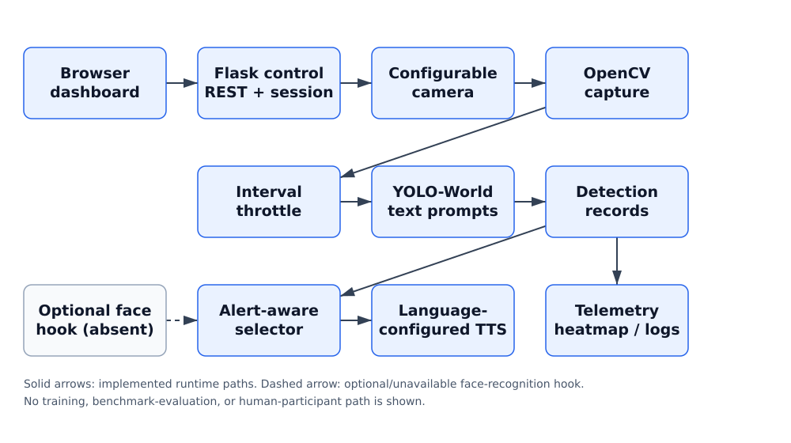
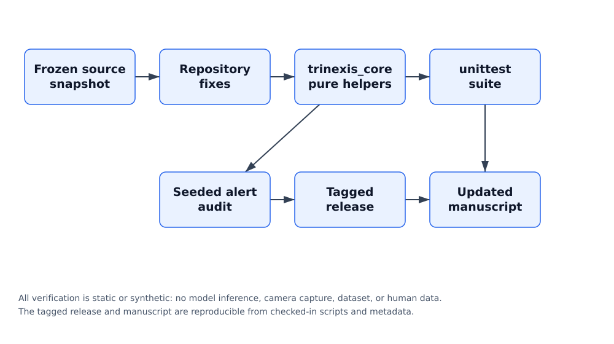

# TRINEXIS: An Interval-Throttled Open-Vocabulary Webcam System with Alert-Aware Speech and Implementation Verification

**Authors and Affiliations**

Yug G. Lakhani¹  
¹Department of Computer Engineering, Gyanmanjari Innovative University, Bhavnagar, Gujarat, India  
Corresponding author: Yug G. Lakhani, yglakhani@gmiu.edu.in  
ORCID: https://orcid.org/0009-0004-2930-4953  

## Abstract

Open-vocabulary detectors can be configured with text prompts, but an interactive prototype also needs deterministic control flow, bounded speech, and an honest account of what has and has not been evaluated. This paper presents TRINEXIS, a Flask-based web system that couples an interval-throttled YOLO-World detector, a browser dashboard, language-configured speech output, session telemetry, and an alert-aware narration policy. The repository-fix pass adds AGPL-3.0 licensing, documentation, pinned requirements, configurable camera and security settings, separate capture and inference counters, time-based heatmap decay, a non-metric distance index, and standard-library tests. The central software contribution ranks alert objects before truncating the spoken shortlist. In a seeded synthetic regression audit of 1,000 detection cases, the legacy ordering omitted the alert object in 68.1% of cases, whereas the revised selector omitted it in 0.0%. A tagged release and an implementation-verification appendix make the result reproducible. No labeled detection dataset, hardware timing campaign, distance calibration, translated-template rating, or human-participant study was conducted; therefore no detection-quality, latency, distance-error, robustness, or assistive-effectiveness result is claimed. The manuscript is positioned as a software/technical report and a baseline for a later empirical workshop paper.

**Keywords / Index Terms:** open-vocabulary detection; alert-aware narration; research software; reproducible configuration; speech interface; implementation verification

## I. INTRODUCTION

### A. Motivation and Scope

Object detection predicts bounding boxes and semantic labels for objects in an image. The YOLO family formulated detection as a single regression problem [1], and COCO-style benchmarks standardized evaluation over a fixed vocabulary of 80 released categories [2]. Vision-language pre-training then broadened the interface: CLIP enabled zero-shot transfer from natural-language supervision [3], Grounding DINO fused language and vision for open-set detection [4], and YOLO-World introduced a prompt-then-detect paradigm [5]. Ultralytics exposes that family through a set_classes interface [6]. These advances make it feasible to build interactive applications around user-selected object names.

TRINEXIS is a concrete integration of those components. Its maintained backend, app23.py, combines Flask control routes [7], OpenCV capture [8], Ultralytics YOLO [15], gTTS speech [9], a browser dashboard, detection logs, a heatmap, and session telemetry. The original manuscript treated a static source audit as the principal result. The present revision instead repairs the software, states one clear contribution, and reports a deterministic software regression result while preserving an explicit evidence boundary.

### B. Problem and Contribution

The reviewer critique identified four decisive weaknesses: no empirical results, repository defects reported rather than fixed, known bugs documented rather than repaired, and no crisp novelty claim. The first weakness cannot be removed without new experiments; this paper does not simulate them. The remaining weaknesses are addressed directly. The selected contribution is alert-aware, language-configured scene narration in an interval-throttled open-vocabulary webcam pipeline: the system ranks user-designated alert objects before choosing the short spoken shortlist.

- A repaired, documented, and testable Flask/YOLO-World application with AGPL-3.0 licensing [25], pinned requirements, configurable camera/security settings, and vector figures.
- An alert-aware speech selector that ranks alerts before shortlist truncation, with a seeded synthetic before/after regression audit.
- A reproducible implementation-verification appendix, a tagged release [24], and a short scope statement that removes template padding.
- An explicit boundary between verified software behavior and the detection, latency, distance, translation, and human-subject evidence that remains unavailable.

### C. Venue Positioning and Evidence Boundary

No target journal or conference was supplied. Consequently, this manuscript retains a generic single-column format and numeric citations; the current Guide for Authors and official template must be applied before any submission. As it stands, an arXiv preprint or technical report is the best fit. A JOSS submission requires an OSI-approved license, clear documentation, tests, feature completeness, and a sustained public development history [22]; SoftwareX requires its official short software-paper template, a README, a LICENSE file, and an open repository [23]. An applied-vision, HCI, or assistive-technology workshop paper becomes realistic only after the experiments in Table V are performed.

No quantitative detection evaluation, baseline comparison, ablation, statistical test, robustness test, external validation, computational-cost measurement, or human-participant evaluation was performed. No superiority, detection accuracy, mean average precision, latency, distance error, multilingual comprehension, real-world effectiveness, clinical readiness, assistive benefit, deployment success, or user-study claim is made.

## II. RELATED WORK / LITERATURE REVIEW

### A. Detection and Open-Vocabulary Models

The original YOLO paper evaluated PASCAL VOC 2007/2012 and artwork-domain generalization on the Picasso and People-Art datasets; it did not evaluate on COCO [1]. COCO later supplied a fixed-vocabulary benchmark [2]. CLIP [3], Grounding DINO [4], YOLO-World [5], OWL-ViT [11], GLIP [12], Detic [13], and YOLOE [14] represent successive approaches to language-conditioned or open-vocabulary recognition. Their published results were obtained under distinct datasets, splits, prompts, hardware, and protocols, so they are not treated here as comparative baselines for TRINEXIS. Table I summarizes scope and non-comparability.

**TABLE I. VERIFIED RELATED WORK AND NON-COMPARABILITY**

| Source | Contribution | Verified evaluation context | Relevance and limitation |
| --- | --- | --- | --- |
| Redmon et al. [1], 2016 | One-stage YOLO detector | PASCAL VOC 2007/2012; Picasso and People-Art artwork generalization | Established real-time closed-set detection; no COCO evaluation in that paper and a different hardware/protocol context |
| Lin et al. [2], 2014 | Microsoft COCO benchmark | Approximately 328,000 images, 2.5 million labeled instances, 80 released categories | Standard fixed-vocabulary protocol; utils/coco.txt is only a label list in this repository |
| Radford et al. [3], 2021 | CLIP contrastive pre-training | 400 million image–text pairs; zero-shot transfer over more than 30 datasets | Representation learning, not a real-time bounding-box detector |
| Liu et al. [4], 2024 | Grounding DINO, ECCV 2024 published version | Open-set and referring-expression benchmarks under published protocols | Alternative open-set approach; not used in this repository |
| Cheng et al. [5], 2024 | YOLO-World and RepVL-PAN | CVPR 2024, pp. 16901–16911 | Direct model-family basis; published benchmark results are not reproduced here |
| Minderer et al. [11]; Li et al. [12]; Zhou et al. [13]; Wang et al. [14] | OWL-ViT, GLIP, Detic, YOLOE | ECCV/CVPR/arXiv protocols with distinct vocabularies and datasets | Expanded open-vocabulary context; incompatible with this repository's prompts and runtime |
| Alqahtani et al. [19], 2024 | Edge accuracy–latency–energy benchmark | YOLOv8, SSD, and EfficientDet Lite across heterogeneous edge devices | Motivates separate timing instrumentation; its measurements are not reused as TRINEXIS results |

### B. Assistive Interfaces, Speech, and Privacy

Remote sighted assistance has been studied through Be My Eyes [16], while Seeing AI [17] and AI scene-description applications [18] illustrate practical auditory presentation of visual information. These systems are relevant to the design space but do not validate TRINEXIS. The repository configures 72 language codes and 62 top-level speech resources; the translations were not produced or checked under a documented protocol, so the title uses “language-configured” rather than “multilingual.” Camera-based systems also raise privacy and face-recognition concerns [20], [21]. The optional face-recognition hook remains unavailable, and no consent, retention, or biometric-processing protocol is claimed.

### C. Research Software and Reproducibility

Git LFS stores small pointer files in Git while large model content is held elsewhere [10]. The original audit cited a bare commit that did not contain the audit script. This revision instead cites a tagged GitHub release [24] and provides CITATION.cff, codemeta.json, dependency-license notes, and pinned manifests. A Zenodo DOI is pending author authorization and is not claimed. The static audit is retained only as an appendix-level implementation-verification record, not as the paper's principal finding.

---

## III. UPDATED SYSTEM DESIGN

### A. Architecture and Control Flow

Figure 1 shows the repaired runtime and control flow. A browser client calls Flask control routes and displays a Motion JPEG stream. A configurable camera backend supplies frames to OpenCV. Detector calls are gated by an interval throttle, after which YOLO-World produces text-conditioned detection records. Those records feed visual overlays, a relative distance index, a time-decayed heatmap, session telemetry, and an alert-aware speech selector. Optional face recognition is shown as a dashed, unavailable path. There is no training or benchmark-evaluation path.



*Fig. 1. Updated TRINEXIS system architecture. Solid arrows denote implemented runtime paths; the dashed arrow denotes an optional/unavailable face-recognition hook. Vector SVG/PDF versions are provided in the release artifacts.*

### B. Interval Throttle and Alert-Aware Narration

Let t be the current capture time, t_prev the previous detector invocation, and Δ the configured throttle interval. A detector call is admitted when

> `t - t_prev >= Delta.                                         (1)`

The maintained default is Δ = 1.5 s and the spoken shortlist is limited to two objects. Let A be the set of user-designated alert names, c(o) the detector confidence, and d(o) the relative distance index. The updated selector sorts every detection record o by the ascending key

> `R(o) = (I_alert(o), -c(o), d(o)),                            (2)`

and only then takes the first two records. In Eq. (2), I_alert(o) = 0 when o.name is in A and 1 otherwise; alert objects therefore receive priority regardless of whether they are among the two highest-confidence detections. The legacy implementation sorted by confidence, truncated to two, and only then applied alert-aware ranking inside the shortlist, which could drop a low-confidence alert object.

### C. Time-Based Heatmap and Relative Distance Index

The original heatmap multiplied the accumulator by 0.995 per annotated frame, making decay depend on camera frame rate. The revised accumulator uses elapsed wall-clock time dt and a configurable half-life tau:

> `H_t = 2^(-dt/tau) * H_(t-1) + sum_i C(c_i; 35).               (3)`

In Eq. (3), H_t is the heatmap at time t, C(c_i; 35) is a filled circle of radius 35 pixels centered on detection box c_i, and tau defaults to 60 s. This makes the decay independent of frame rate. The distance overlay was also changed from a centimetre-labelled value to a unitless relative index

> `d_idx = (W * F) / max(w_px, 1),                               (4)`

where w_px is the observed box width, W = 60, and F = 360. W and F are heuristic constants, not calibrated physical measurements; d_idx has no metric unit and must not be interpreted as centimetres or metres.

### D. Configuration, Security, and Deployment

Camera index, backend, resolution, host, port, optional API token, single-client mode, client timeout, session secret, and heatmap half-life are read from environment variables. The default bind address is 127.0.0.1 rather than 0.0.0.0. /set_model accepts only a checked-in model allowlist. Mutating control endpoints can require an X-API-Token or Bearer header, and single-client arbitration prevents a second browser from mutating shared state while the first session is active. Capture-frame and detector-invocation rates are reported separately.

### E. Scope and Evidence Boundary

This is a software-focused technical report. Sections that would otherwise describe training, baselines, hyperparameter sweeps, statistical evaluation, and ablations are replaced by this short scope statement and Table V. Those sections should be reinstated only with genuine experimental data. No target-venue template or citation style was supplied; the numeric citation style is a fallback.

**TABLE II. REPOSITORY FIXES AND VERIFICATION**

| Reviewer issue | Change in v0.2.0-updated | Verification |
| --- | --- | --- |
| Missing README, license, requirements, tests | Added AGPL-3.0 LICENSE [25], root README, pinned requirements.txt, CITATION.cff, codemeta.json, .env.example, and THIRD_PARTY_LICENSES.md | Source-contract tests and README instructions |
| ACCURACY label bound to mean confidence | Renamed dashboard label to AVG CONFIDENCE | Source-contract test |
| Alert objects dropped before reranking | Rank alerts before shortlist truncation via trinexis_core.select_speech_objects | Unit test and seeded synthetic before/after audit |
| Global state shared across clients | Added single-client control arbitration with stale-session timeout | Pure-function unit test |
| Unauthenticated 0.0.0.0 binding | Default host 127.0.0.1; optional API token on mutating control routes | Source-contract and pure-function tests |
| Arbitrary /set_model string | Model allowlist with HTTP 400 on rejection | Unit test |
| Frame-rate-dependent heatmap decay | Wall-clock exponential decay with configurable half-life | Unit test |
| Centimetre-labelled distance heuristic | Unitless relative distance index with explicit non-calibration note | Unit test and source-contract test |
| Windows-only CAP_DSHOW and camera index 1 | Configurable TRINEXIS_CAMERA_INDEX and TRINEXIS_CAMERA_BACKEND | Unit and source-contract tests |
| Single FPS display | Separate capture_fps and inference_fps counters and dashboard displays | Source-contract test |
| Small raster-only figures | Enlarged PNG plus standalone SVG and vector-PDF exports | make_updated_figures.py |

## IV. IMPLEMENTATION VERIFICATION

### A. Verification Environment

All checks were static or synthetic. The preparation environment used Python 3.11.2 with the standard library for tests; manuscript and figure generation used the pinned packages in paper/requirements-paper.txt. No model weights were hydrated, no camera was opened, no Flask server was run, no network speech request was made, and no human participant was involved. Figure 2 summarizes the workflow.



*Fig. 2. Implementation-verification workflow. Every step is static or synthetic; no model inference, camera capture, labeled dataset, or human data is used. Vector SVG/PDF versions are provided in the release artifacts.*

### B. Alert-Selection Before/After Result

The alert-selection audit generated 1,000 seeded synthetic detection cases. Each case contained six detection records, exactly one alert object, and a two-object speech shortlist. Confidences and distance indices were drawn from fixed ranges with seed 20261110. The legacy ordering omitted the alert object in 681 of 1000 cases (68.1%). The updated ordering omitted it in 0 of 1000 cases (0.0%), an absolute reduction of 68.1 percentage points. This is a deterministic software regression result, not a detection-quality or user-benefit measurement.

**TABLE III. SEEDED SYNTHETIC ALERT-SELECTION REGRESSION**

| Metric | Legacy ordering | Updated ordering | Change |
| --- | --- | --- | --- |
| Cases with a configured alert object | 1,000 | 1,000 | — |
| Alert omissions from the two-object shortlist | 681 | 0 | −681 |
| Omission rate | 68.1% | 0.0% | −68.1 pp |
| Evidence type | Synthetic software regression | Synthetic software regression | No model inference |

### C. Unit and Source-Contract Tests

The standard-library unittest suite contains 24 tests: 14 pure-policy tests and 10 source-contract tests. All 24 passed with zero failures and zero errors. The suite covers camera configuration, model allowlisting, alert-first ranking, legacy drop reproduction, time-based decay, relative distance index, rate calculation, token validation, single-client timeout, license/readme/requirements presence, corrected UI labels, configurable host/backend, and the absence of metric centimetre labels in the primary backend.

**TABLE IV. TEST-SUITE SUMMARY**

| Test group | Tests | Failures | Errors |
| --- | --- | --- | --- |
| trinexis_core pure-policy tests | 14 | 0 | 0 |
| Repository/source-contract tests | 10 | 0 | 0 |
| Total | 24 | 0 | 0 |

### D. Release and Reproducibility

The revised software and manuscript are associated with GitHub release v0.2.0-updated [24], CITATION.cff, and codemeta.json. The bare commit citation from the earlier manuscript is removed. A Zenodo DOI has not been minted because that requires author authorization; the release URL is cited instead. Appendix A lists reproduction commands, and Appendix B lists the principal artifacts.

**TABLE V. REQUIRED FUTURE EVIDENCE — PROTOCOLS, NOT RESULTS**

| Evidence gap | Required protocol | Claim withheld until completed |
| --- | --- | --- |
| Detection quality | Labeled COCO/LVIS subset or self-annotated set; report mAP, precision, recall, and confusion summaries; compare 455-prompt and task-specific vocabularies | Detection accuracy, vocabulary superiority, robustness |
| Confidence/vocabulary ablation | Evaluate 0.15, 0.25, and 0.35 thresholds under identical splits | Threshold recommendation |
| Latency | Instrument capture, inference, TTS, playback, and rendering on declared CPU/GPU hardware; report median and 95th percentile | Runtime or edge suitability |
| Distance calibration and speech | Measure 5–10 objects at known distances; consented speakers rate translated templates | MAE, metric distance, multilingual comprehension, user benefit |

## V. DISCUSSION

### A. What the Fixes Establish

The revised release establishes that the prototype can be licensed, documented, configured, and tested without loading model weights. It also converts one documented defect into a measurable software result: alert-aware ranking before truncation eliminates alert omissions in the seeded synthetic cases. The expanded related work clarifies that published detector benchmarks are not comparable to this repository's throttled webcam pipeline. The corrected YOLO table entry, published Grounding DINO citation, normalized backend-resource counts, and reduced CRediT roles remove the textual inconsistencies identified in review.

### B. Limitations

The most important limitation is unchanged: no empirical performance result exists. The 455-prompt vocabulary and 0.15 confidence threshold are not justified by an ablation. The 72 language codes and 62 speech resources have no documented translation procedure or human check. The distance index is not calibrated, the heatmap half-life is a design choice rather than a fitted parameter, and single-client mode avoids cross-client mutation rather than providing full per-session isolation. The optional face-recognition hook remains absent. No authentication is enforced unless an API token is configured, and deployment behind a reverse proxy with HTTPS remains the user's responsibility.

### C. Ethical and Practical Implications

Camera-based interfaces can expose bystanders and sensitive environments. Privacy, consent, retention, and biometric-processing policies must be defined before any real-world or assistive-use study [20], [21]. The AGPL-3.0 license [25] and dependency-license notice clarify redistribution obligations but do not substitute for an ethics review. The system should not be described as assistive technology for blind or low-vision users until a consented study demonstrates benefit.

## VI. CONCLUSION AND FUTURE WORK

This revision presents TRINEXIS as a documented, testable, interval-throttled open-vocabulary webcam system with an alert-aware speech policy. It repairs the repository defects that could be fixed without new data, removes template padding, corrects inaccurate citations and labels, and reports one genuine deterministic software result. It does not claim empirical detection, latency, distance, translation, or user benefit. Future work should proceed in four steps:

- Evaluate detection quality on a labeled dataset and ablate vocabulary size and confidence thresholds.
- Instrument capture, inference, speech, and rendering separately on declared CPU/GPU hardware.
- Calibrate the distance proxy at known distances or retain the unitless index with its current disclaimer.
- Obtain ethics approval for translated-template ratings and any assistive-use study, then upgrade the manuscript into a workshop paper.

## DECLARATIONS

### A. Funding and Competing Interests

No external funding was reported for this work. No competing interests were disclosed by the author.

### B. Author Contributions (CRediT)

Yug G. Lakhani: conceptualization, methodology, software, formal analysis, investigation, writing—original draft, and writing—review and editing. Validation and data curation are not listed because no validation dataset or curated research data were used.

### C. AI-Tool Disclosure

Arena.ai Agent Mode was used for source auditing, figure generation, repository-fix scripting, and manuscript formatting. The author is responsible for the final manuscript and for verifying all declarations before submission.

### D. Data and Code Availability

The software and manuscript are available from GitHub release v0.2.0-updated [24] under AGPL-3.0-only [25]. Model weights are Git LFS pointers and must be fetched separately [10]. No labeled dataset, experimental log, or valid Zenodo DOI is claimed. Dependency licenses are documented in THIRD_PARTY_LICENSES.md.

---

## REFERENCES

[1] J. Redmon, S. Divvala, R. Girshick, and A. Farhadi, “You Only Look Once: Unified, Real-Time Object Detection,” in Proc. IEEE/CVF Conf. Comput. Vis. Pattern Recognit. (CVPR), 2016, pp. 779–788, doi: 10.1109/CVPR.2016.91.

[2] T.-Y. Lin et al., “Microsoft COCO: Common Objects in Context,” in Proc. Eur. Conf. Comput. Vis. (ECCV), 2014, pp. 740–755.

[3] A. Radford et al., “Learning Transferable Visual Models From Natural Language Supervision,” in Proc. Int. Conf. Mach. Learn. (ICML), PMLR 139, 2021, pp. 8748–8763.

[4] S. Liu et al., “Grounding DINO: Marrying DINO with Grounded Pre-Training for Open-Set Object Detection,” in Computer Vision – ECCV 2024, LNCS vol. 15105, 2024, pp. 38–55, doi: 10.1007/978-3-031-72970-6_3.

[5] T. Cheng, L. Song, Y. Ge, W. Liu, X. Wang, and Y. Shan, “YOLO-World: Real-Time Open-Vocabulary Object Detection,” in Proc. IEEE/CVF Conf. Comput. Vis. Pattern Recognit. (CVPR), 2024, pp. 16901–16911, doi: 10.1109/CVPR52733.2024.01599.

[6] Ultralytics, “YOLO-World documentation,” accessed Nov. 10, 2026. [Online]. Available: https://docs.ultralytics.com/models/yolo-world/

[7] Flask Project, “Flask documentation,” accessed Nov. 10, 2026. [Online]. Available: https://flask.palletsprojects.com/

[8] OpenCV, “Getting Started with Videos,” accessed Nov. 10, 2026. [Online]. Available: https://docs.opencv.org/4.13.0/dd/d43/tutorial_py_video_display.html

[9] P. N. Durette, “gTTS: Python library and CLI tool to interface with Google Translate's text-to-speech API,” GitHub repository, accessed Nov. 10, 2026. [Online]. Available: https://github.com/pndurette/gTTS

[10] Git LFS Project, “Git LFS Specification: The Pointer,” accessed Nov. 10, 2026. [Online]. Available: https://github.com/git-lfs/git-lfs/blob/main/docs/spec.md

[11] M. Minderer et al., “Simple Open-Vocabulary Object Detection with Vision Transformers,” in Proc. Eur. Conf. Comput. Vis. (ECCV), 2022, doi: 10.1007/978-3-031-20080-9_42.

[12] L. H. Li et al., “Grounded Language-Image Pre-Training,” in Proc. IEEE/CVF Conf. Comput. Vis. Pattern Recognit. (CVPR), 2022, pp. 10965–10975, doi: 10.1109/CVPR52688.2022.01069.

[13] X. Zhou, R. Girdhar, A. Joulin, P. Krähenbühl, and I. Misra, “Detecting Twenty-Thousand Classes Using Image-Level Supervision,” in Computer Vision – ECCV 2022, LNCS vol. 13669, 2022, pp. 350–368, doi: 10.1007/978-3-031-20077-9_21.

[14] A. Wang, L. Liu, H. Chen, Z. Lin, J. Han, and G. Ding, “YOLOE: Real-Time Seeing Anything,” arXiv:2503.07465, 2025.

[15] Ultralytics, “Ultralytics YOLO,” GitHub repository, accessed Nov. 10, 2026. [Online]. Available: https://github.com/ultralytics/ultralytics

[16] M. Avila, K. Wolf, A. Brock, and N. Henze, “Remote Assistance for Blind Users in Daily Life: A Survey about Be My Eyes,” in Proc. 9th ACM Int. Conf. Pervasive Technol. Related Assistive Environ. (PETRA), 2016, Article 85, pp. 1–2, doi: 10.1145/2910674.2935839.

[17] Microsoft, “Seeing AI,” accessed Nov. 10, 2026. [Online]. Available: https://www.microsoft.com/en-us/ai/seeing-ai

[18] R. E. Gonzalez Penuela, J. Collins, C. L. Bennett, and S. Azenkot, “Investigating Use Cases of AI-Powered Scene Description Applications for Blind and Low Vision People,” in Proc. CHI Conf. Human Factors Comput. Syst. (CHI), 2024, doi: 10.1145/3613904.3642211.

[19] D. K. Alqahtani, M. A. Cheema, M. A. Rodriguez, and A. N. Toosi, “A Comprehensive Evaluation of Deep Learning Object Detection Models on Heterogeneous Edge Devices,” arXiv:2409.16808, 2024.

[20] I. D. Raji, T. Gebru, M. Mitchell, J. Buolamwini, J. Lee, and E. Denton, “Saving Face: Investigating the Ethical Concerns of Facial Recognition Auditing,” in Proc. AAAI/ACM Conf. AI, Ethics, Soc. (AIES), 2020, pp. 145–151, doi: 10.1145/3375627.3375820.

[21] M. R. Hasan, R. Guest, and F. Deravi, “Presentation-level Privacy Protection Techniques for Automated Face Recognition—A Survey,” ACM Comput. Surv., vol. 55, no. 13s, Article 286, 2023, doi: 10.1145/3583135.

[22] Journal of Open Source Software, “Submitting a paper to JOSS,” openjournals/joss GitHub documentation, accessed Nov. 10, 2026. [Online]. Available: https://github.com/openjournals/joss/blob/main/docs/submitting.md

[23] Elsevier, “SoftwareX Guide for Authors,” accessed Nov. 10, 2026. [Online]. Available: https://www.elsevier.com/journals/softwarex/2352-7110/guide-for-authors

[24] Unusualyug, “tech_yolo release v0.2.0-updated,” GitHub, 2026. [Online]. Available: https://github.com/Unusualyug/tech_yolo/releases/tag/v0.2.0-updated

[25] Free Software Foundation, “GNU Affero General Public License, Version 3,” 2007. [Online]. Available: https://www.gnu.org/licenses/agpl-3.0.html

## APPENDIX A. REPRODUCTION COMMANDS

```text
git clone https://github.com/Unusualyug/tech_yolo.git
cd tech_yolo
git checkout v0.2.0-updated
python3 -m pip install -r requirements.txt
git lfs install && git lfs pull
python3 experiments/alert_selection_audit.py
python3 -m unittest discover -s tests -v
python3 -m pip install -r paper/requirements-paper.txt
python3 paper/make_updated_figures.py
python3 paper/build_updated_manuscript.py
```

## APPENDIX B. PRINCIPAL ARTIFACTS

- paper/tech_yolo_updated_research_paper.pdf, .docx, and .md: updated author manuscript.
- paper/artifacts/alert_selection_audit.json: seeded synthetic before/after alert-selection result.
- paper/artifacts/fig1_system_architecture_updated.{png,svg,pdf} and fig2_implementation_verification.{png,svg,pdf}: figure exports.
- paper/artifacts/updated_repository_audit.json: machine-readable release/test summary.
- trinexis_core.py, tests/, experiments/, CITATION.cff, codemeta.json, README.md, LICENSE, requirements.txt, and THIRD_PARTY_LICENSES.md: repository-fix artifacts.
